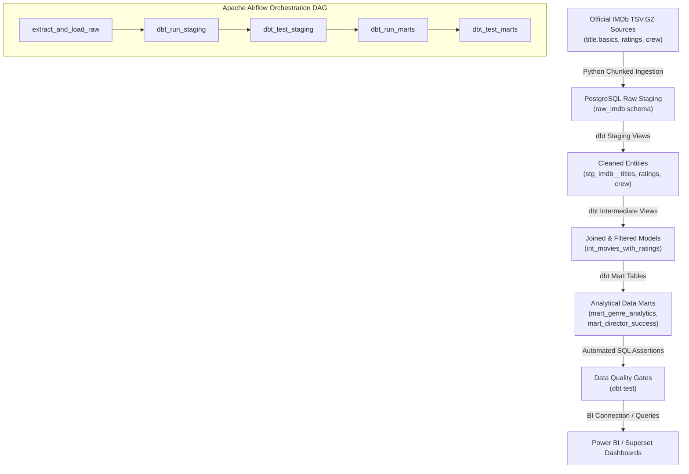

# IMDb Movie Analysis Data Warehouse Pipeline

An automated, locally reproducible Data Engineering pipeline that ingests daily updated movie datasets from official IMDb sources, cleans and loads them into an analytical Data Warehouse (PostgreSQL), models them through multi-layer analytical transformations using **dbt Core** (Staging $\rightarrow$ Intermediate $\rightarrow$ Marts), orchestrates workflow scheduling via **Apache Airflow**, and enforces strict Data Quality gates.

---

## Business Goal

To provide data analysts, product managers, and BI teams with a trusted, daily-updated analytical warehouse capable of tracking macro cinema trends, evaluating director career performance, and slicing movie ratings and popularity across genres and decades.

## Key Engineering Features Demonstrated

- **Robust Data Ingestion**: Replaces fragile HTML web scraping with batch/streaming extraction of official IMDb compressed TSV archives (`.tsv.gz`).
- **Deterministic Sampling & Offline Mode**: Includes a built-in `--sample` generator enabling instant unit testing and offline demo execution without downloading gigabytes over the network.
- **Three-Layer dbt Analytical Modeling**:
  - `staging`: Normalizes raw text types, handles IMDb null markers (`\N`), and parses year/runtime integers (`stg_imdb__*`).
  - `intermediate`: Joins title metadata with vote volumes and casting arrays, applying quality thresholds (`int_movies_with_ratings`).
  - `marts`: Delivers final analytical dimensions and fact aggregations (`mart_genre_analytics`, `mart_director_success`, `mart_yearly_cinema_evolution`).
- **Data Quality Assurance**: Enforces primary key uniqueness, referential integrity, and domain constraints via automated dbt generic tests and custom expressions.
- **Containerized Orchestration**: Self-contained `docker-compose` stack running PostgreSQL 15 and Apache Airflow 2.8+ standalone scheduler/webserver.

---

## Architecture



---

## Tech Stack

- **Language**: Python 3.10+ (`pandas`, `requests`, `sqlalchemy`, `pytest`)
- **Data Warehouse**: PostgreSQL 15 (Alpine Linux container)
- **Transformation**: dbt Core 1.7+ (`dbt-postgres`)
- **Orchestration**: Apache Airflow 2.8+
- **Containerization**: Docker & Docker Compose

---

## Quick Start (How to Run Locally)

### Prerequisites
- [Docker](https://docs.docker.com/get-docker/) and Docker Compose installed.
- (Optional) Python 3.10+ installed locally for fast unit testing.

### 1. Launch Container Infrastructure
Start PostgreSQL and Apache Airflow in the background:
```bash
make up
```
*Note: Airflow UI will be available at `http://localhost:8080` (credentials: `admin` / `admin`).*

### 2. Run Data Ingestion
Ingest sample IMDb data into the PostgreSQL raw schema:
```bash
make ingest
```
*(To download live datasets from IMDb, run: `python src/ingest_imdb.py` without the `--sample` flag).*

### 3. Execute dbt Transformations & Tests
Run all analytical models from staging to marts:
```bash
make dbt-run
```
Execute automated Data Quality assertions:
```bash
make dbt-test
```

---

## Data Model & Key Analytical Queries

### 1. Genre Performance by Decade (`mart_genre_analytics`)
Evaluates volume and weighted average ratings across film genres:
```sql
SELECT genre, decade, total_movies, weighted_avg_rating, total_votes
FROM marts.mart_genre_analytics
WHERE decade >= 1990
ORDER BY total_votes DESC
LIMIT 10;
```

### 2. Director Success Matrix (`mart_director_success`)
Profiles director career consistency and hit ratios ($\ge 7.5$ rating):
```sql
SELECT director_id, total_directed_movies, avg_rating, hit_ratio_percent
FROM marts.mart_director_success
WHERE total_directed_movies >= 3
ORDER BY total_career_votes DESC
LIMIT 10;
```

---

## Project Structure

```text
imdb_movie_analysis/
├── docker-compose.yml       # Container orchestration (Postgres + Airflow)
├── Makefile                 # Shortcut commands for deployment & testing
├── pyproject.toml           # Python packaging and pytest configuration
├── requirements.txt         # Project dependencies
├── dags/
│   └── imdb_daily_dwh_pipeline.py  # Airflow DAG definition
├── src/
│   ├── db.py                # Database manager & schema initializer
│   └── ingest_imdb.py       # TSV extractor, null cleaner, & sample generator
├── dbt_imdb/                # dbt analytics engineering project
│   ├── dbt_project.yml
│   ├── profiles.yml
│   └── models/
│       ├── staging/         # Cleaned views (stg_imdb__*)
│       ├── intermediate/    # Joined business entities
│       └── marts/           # Final analytical dimensions and facts
├── tests/
│   └── test_ingest.py       # Automated unit test suite
└── docs/
    └── STAR_interview_walkthrough.md  # Interview talking points
```

---

## Lessons Learned & Next Improvements

1. **Streaming TSV vs Web Scraping**: Relying on official IMDb compressed dumps guarantees pipeline resilience and eliminates IP rate-limiting issues.
2. **Postgres Array Handling**: Utilizing `string_to_array()` and `lateral unnest()` allowed us to cleanly unroll multi-genre and multi-director mappings without join fan-out bottlenecks.
3. **Future Roadmap**:
   - Integrate incremental dbt models (`materialized='incremental'`) for daily append runs.
   - Connect an open-source Apache Superset container to visualize live interactive dashboards.
